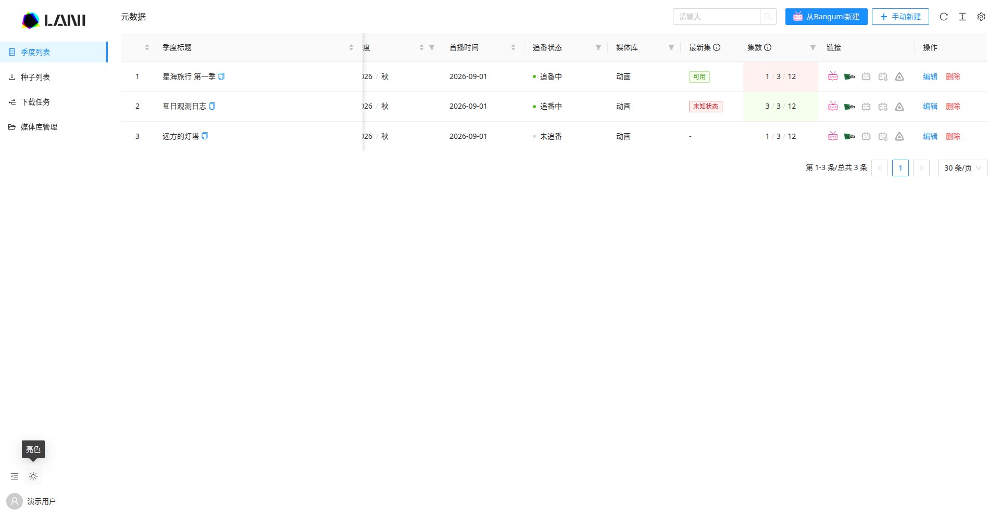
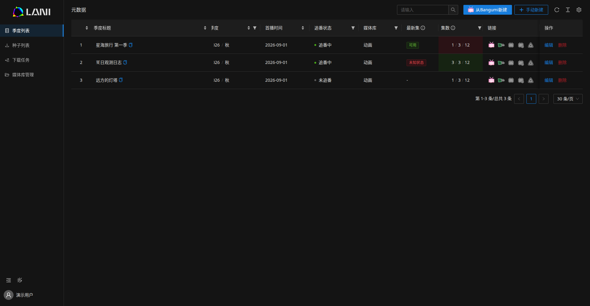

# 主题设计

主题以根节点属性切换，首屏脚本在渲染前应用偏好，减少闪烁。运行时保持页面、表单及弹窗实例，切换主题时保留用户输入和滚动状态。偏好在同源标签页间同步，存储不可用时仍允许当前页面切换。

Umi 3/antd 4 的 Less 样式分别编译亮色和暗色版本，随原有 chunk 加载。这样切换无需下载样式，代价是 CSS 体积和编译时间增加。暗色作用域使用 `:where` 保持选择器优先级，覆盖挂在 body 下的弹窗；动画名称独立，避免覆盖亮色动画。

业务样式统一使用语义颜色变量，标签按主题调整亮度并保留名称对应色相。维护与验证要求见[开发规范](../AGENTS.md)。

| 桌面亮色 | 桌面暗色 |
| --- | --- |
|  |  |

[折叠侧栏](screenshots/theme-desktop-collapsed.png) · [移动端](screenshots/theme-mobile-dark.png) · [下载弹窗](screenshots/theme-modal-dark.png) · [种子选择](screenshots/theme-torrent-selection-dark.png)
